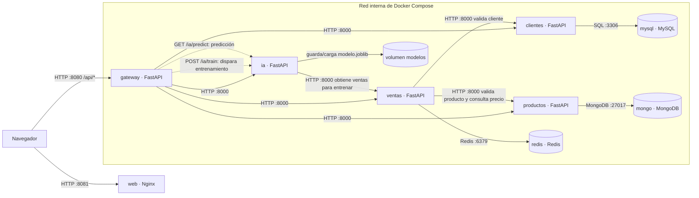

# Parte E: diagrama de arquitectura

Diagrama del despliegue definido en `docker-compose.yml`. Puede visualizarse en
GitHub o en un editor compatible con Mermaid.

## Puertos publicados

| Puerto del equipo | Servicio | Uso |
|---|---|---|
| 8080 | gateway | API para el navegador, scripts y clientes externos |
| 8081 | web | Sitio estático servido por Nginx |
| Sin publicar | microservicios y bases de datos | Acceso solo por la red interna de Compose |

El entrenamiento ocurre en `ia`: solicita las ventas a `ventas`, entrena el
Random Forest y persiste `modelo.joblib` en el volumen `modelos`. Las
predicciones se sirven desde ese mismo servicio.
